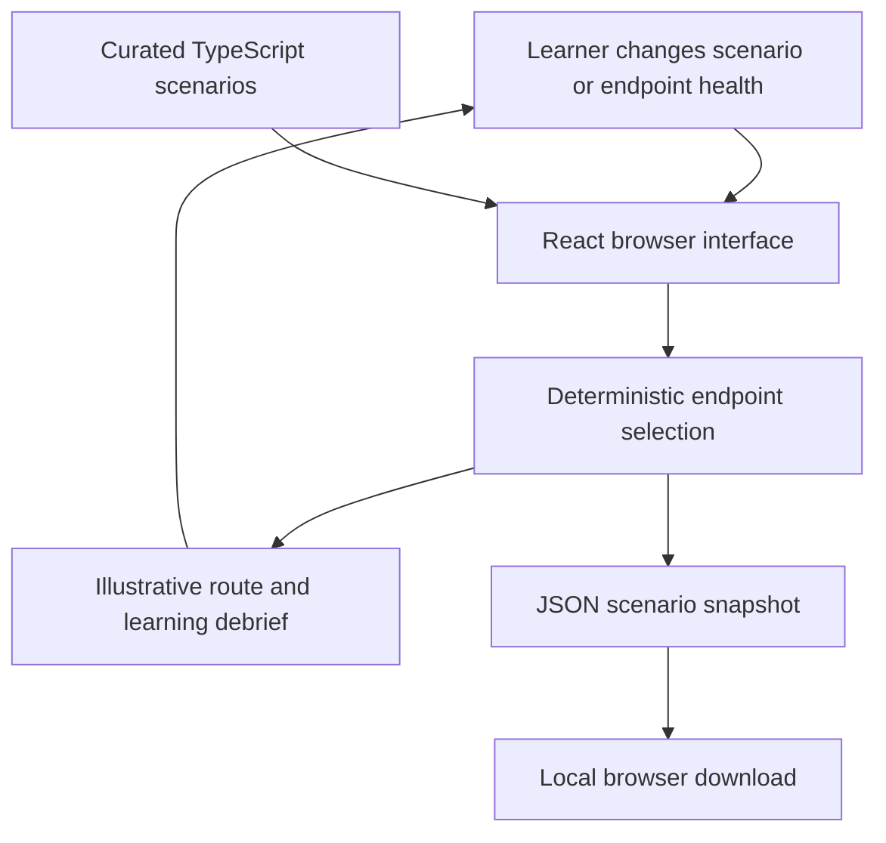

# Route to the Crypt

An interactive cloud-routing learning prototype built with React, TypeScript and Vite. Change endpoint health, inspect the highlighted route and export a scenario snapshot.

**Status:** A deterministic browser model for Kiroween 2026. It does not route real traffic or connect to AWS. The local AWS Emulator integration is proposed separately in PR #1.

## Architecture

## Start here

Run `npm install`, then `npm run dev`; use `npm run build` for the static bundle. Read [scenarioModel.ts](src/lib/scenarioModel.ts), [scenarios.ts](src/data/scenarios.ts) and [PROJECT_PLAN.md](PROJECT_PLAN.md). The [optional Crew Debrief](optional-crew-debrief/README.md) and [emulator PR](https://github.com/mtzanida/route-to-the-crypt/pull/1) describe separate work.

[Previous README and detailed reference](https://github.com/mtzanida/route-to-the-crypt/blob/5970d7a13c1bb8a364b9049009ebc49e542c1e6e/README.md) are retained in Git history. They may describe older assumptions or unmerged plans; the scope above reflects this branch.

License: [MIT](LICENSE).
